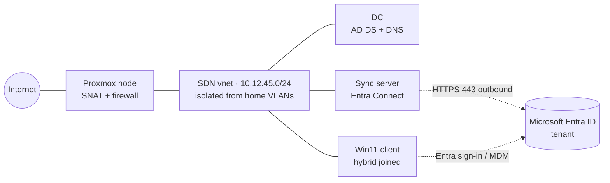

# SC-300 Identity Lab

A hands-on lab for the **Microsoft SC-300 (Identity and Access Administrator)** exam, built on an **isolated software-defined network in Proxmox VE**. It runs a small on-premises Active Directory forest that syncs to a Microsoft Entra ID tenant, so every exam objective can be practiced against a real hybrid environment rather than read about.

The repo is the build log: what was built, why, how it was verified, and what each lab proved.

> **Status:** network layer in progress. See the [roadmap](docs/roadmap.md) for what is done and what is planned. Nothing here is marked done until it has been tested.

## What this demonstrates

- **Hybrid identity:** AD DS synced to Entra ID with Entra Connect / Cloud Sync, hybrid device join, SSO
- **Access management:** Conditional Access, MFA and authentication methods, Identity Protection, PIM
- **Governance:** access reviews, entitlement management, lifecycle workflows
- **Workload identities:** app registrations, service principals, managed identities
- **Network isolation:** Proxmox SDN with a verified boundary between the lab and the home network
- **Documentation habits:** ADRs, test-first verification, reproducible config

## Architecture



| | |
|---|---|
| **Hypervisor** | Proxmox VE 9 cluster, SDN configured at datacenter level |
| **Network** | SDN zone + vnet + subnet, SNAT egress, no route into the home VLANs (to be proven, see [isolation tests](docs/architecture.md#isolation-tests)) |
| **On-prem identity** | Dedicated AD forest, separate from any other domain in the homelab |
| **Cloud identity** | Microsoft Entra ID tenant (developer or trial) |

Design detail: [architecture](docs/architecture.md) · [decisions](docs/adr/)

## Exam coverage

Each lab maps to a skill area of the SC-300 study guide. Check Microsoft's current [study guide](https://learn.microsoft.com/credentials/certifications/resources/study-guides/sc-300) for the live objective list, since weightings change.

| Skill area | Labs | Status |
|---|---|---|
| Implement identities in Entra ID | tenant setup, custom domain, users and groups, hybrid sync | 🗓️ Planned |
| Authentication and access management | MFA, Conditional Access, Identity Protection, PIM | 🗓️ Planned |
| Workload identities | app registrations, enterprise apps, managed identities | 🗓️ Planned |
| Identity governance | access reviews, entitlement management, lifecycle workflows | 🗓️ Planned |

Lab write-ups live in [`docs/labs/`](docs/labs/) and follow a [template](docs/labs/TEMPLATE.md): objective, steps, evidence, and what went wrong.

## Repository layout

```
docs/architecture.md   network design, addressing, isolation tests
docs/roadmap.md        phases and status
docs/adr/              design decisions
docs/labs/             one write-up per lab
docs/runbooks/         repeatable build procedures
sdn/                   SDN configuration as code
scripts/               helper scripts
```

## Security notes

No tenant IDs, credentials, or keys are committed. Screenshots are redacted before they are added to `docs/images/`.
